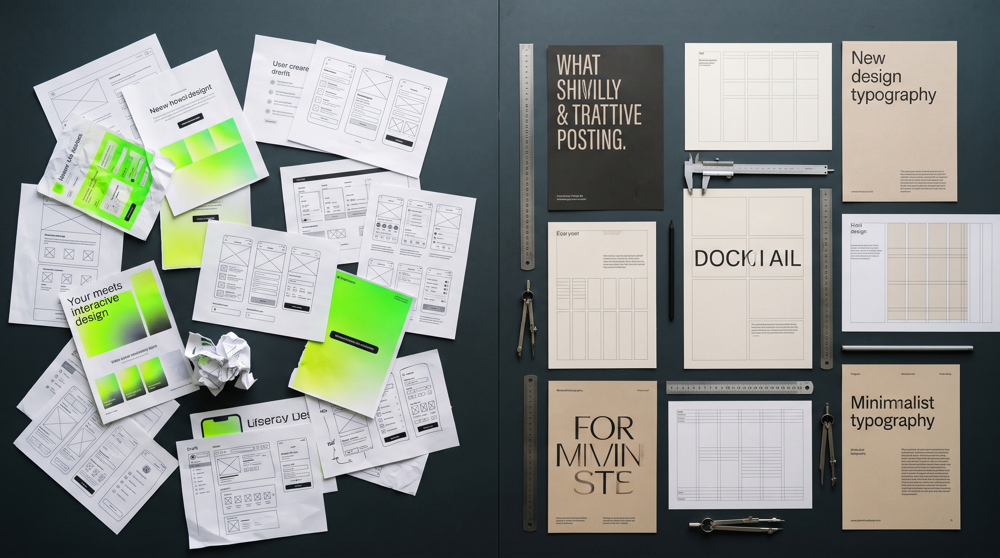
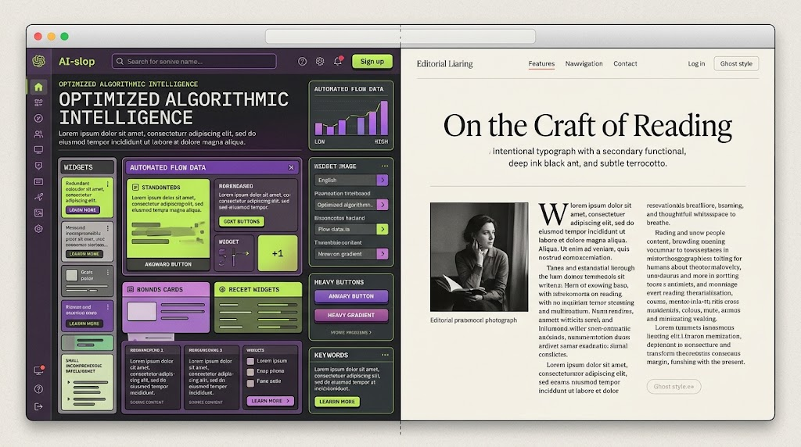
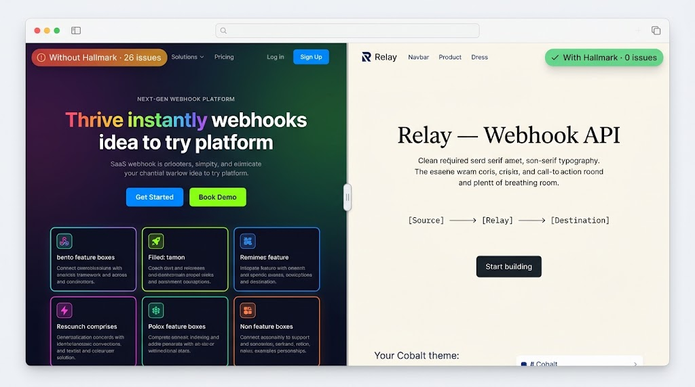
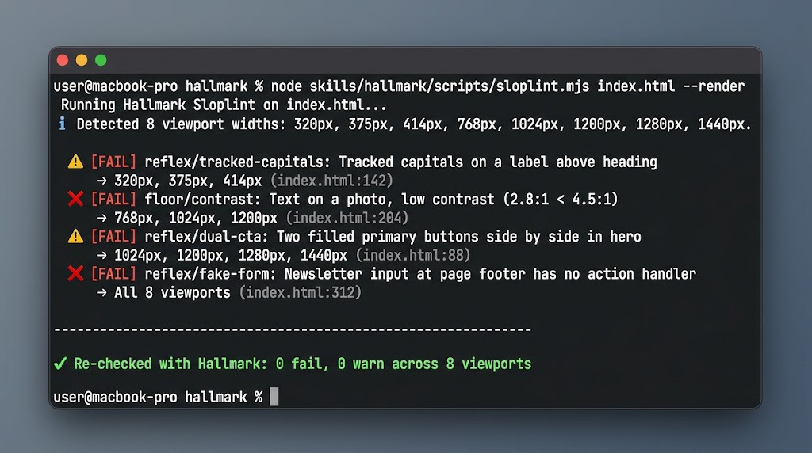

{
  "title": "单日暴涨 2200 星！Together AI 大佬开源的 Hallmark，真能消灭 AI 烂设计吗？",
  "draft": false,
  "weight": 2,
  "summary": "Nutlope 的开源项目 hallmark 今天单日暴涨超过 2200 颗星，直接冲到了很多开发者的信息流中心。",
  "tags": [
    "AI 工具",
    "产品观察"
  ],
  "importedAt": "2026-11-03",
  "sourceURL": "https://ucnbjaetidak.feishu.cn/wiki/XXmLwPH0HimH5Qkh0MNc4Oz0nRg",
  "cover": {
    "image": "image-01.jpg",
    "hiddenInSingle": true
  }
}




Nutlope 的开源项目 <a href="https://github.com/Nutlope/hallmark">hallmark</a> 今天单日暴涨超过 2200 颗星，直接冲到了很多开发者的信息流中心。


项目标榜的定位极具诱惑力：专为 Claude Code、Cursor、Codex 等 Coding Agent 设计的“反 AI 垃圾设计”（Anti-AI-slop）设计规范 Skill。


说实话，第一眼看到官方宣称的“48 套材质系统”、“无头浏览器实时打分”、以及“干掉所有 AI 生成感”时，我的第一反应不是兴奋，而是冷静——因为只要你真正试过让大模型写前端页面，就会知道所谓“AI 审美灾难”的根源，从来就不是模型没有看够精美的 CSS。


它是给 Agent 装了一套极为严苛的刑具，去暴力纠偏大模型写 UI 时的生理性恶习；但别高兴得太早，如果你依然只给它一句模糊的需求，它依然无法替你做出真正有灵魂的网页。





### 只要你用 Codex 写过落地页，就一定经历过这三层绝望

我们先不聊高大上的架构，聊点真实的体感。


如果你和团队尝试过直接把需求扔给 Coding Agent 搓落地页，你大概率会完整踩过以下这三层坑：


第一层绝望是「一句话直接生成」。你输入“帮我做一个高大上的 SaaS 产品首页”，模型秒级吐出代码，打开一看，丑得极其整齐划一：泛着廉价荧光的淡绿色背景、莫名其妙的粗黑方块边框，再加上两个居中并排、颜色刺眼的巨大主按钮。


第二层绝望是「先对话敲定方案再生成」。你学聪明了，不搞一句话直出，先跟它在聊天框里反复推敲产品逻辑；模型吐出来的方案看起来极其专业，全套设计术语拉满，但如果你本身没学过专业 UI 设计，你根本看不出其中的致命破绽。


结果代码一跑起来，你赫然发现自己得到了一份“套了层花哨背景的飞书文档”：左边是一个钉死的目录式树状导航栏，右边是平铺直叙的苍白正文，毫无信息节奏与交互空间感，怎么看都不像是一个面对真实用户的产品网站。


第三层绝望是「找参考图给它抄」。你甚至把成熟产品的截图、色号搭配、动态效果一五一十喂给它，结果出来的页面却像一份糟糕的 PPT：大模型极其执念于在每一个大标题旁边、或者稍有留白的区域，硬塞一行全大写、拉大字距的无意义微型小字标签。


这种无处不在的“标签癣”，把原本该有的呼吸感切割得稀碎，元素杂乱过载，直接把整个页面的档次拉到了最底层的外包水平。





### Hallmark 的本质：不是赐予 AI 灵感，而是物理断绝它的“手贱”

为什么会有这种现象？


大模型的概率生成机制天然偏好局部稠密，它在训练集里学到了太多被搜索引擎 SEO 污染的营销垃圾模板，导致它一旦遇到空白区域，就会本能地想要“填充内容”。


<a href="https://github.com/Nutlope/hallmark">Nutlope/hallmark</a> 最聪明的地方，在于它的作者 Hassan El Mghari（Together AI 开发者关系负责人）根本没有试图去“启发”大模型的艺术直觉，而是直接建立了一套无情的工程阻断器。


它把对页面的审查拆成了三道硬门槛：


第一道叫「地板红线（The Floor）」。这是绝对不允许违背的死线，包括对比度过低、可访问性聚焦丢失、减弱动态偏好失效、以及最关键的——“严禁编造事实（Invented Facts）”和移动端布局崩塌；只要踩中任何一条，构建直接失败。


第二道叫「条件反射审查（Reflex Gates）」。大模型写前端有一堆臭名昭著的默认手癖：标题顶上悬浮的小眉标（eyebrows）、大标题里强行挑选一个单词刷上彩虹渐变色、并排两个同样抢眼的实底主按钮、以及不管什么类型的网站页面底部都硬塞一个毫无用处的 Email 订阅框与假表单。


在 Hallmark 的规则库里，这套手癖被明码标价列成了黑名单，除非你在 Prompt 里专门备注了合理解释，否则一律驳回重写。


第三道叫「工艺收尾检查（Finish Checks）」。针对字偶间距、微质感与边界留白做微调，作为软性评分标准。


为了让这套规则不沦为空口白话，Hallmark 甚至没有完全相信 LLM 的自我反思，而是直接在底层捆绑了 <code>puppeteer-core</code> 和真实的无头 Chrome 浏览器。


每次生成页面后，它会在 8 种不同的屏幕视口宽度下启动无头浏览器真实渲染，运行 <code>sloplint.mjs --render</code> 进行像素级和 DOM 树检验，最后再唤起一个完全没有历史记忆干扰的独立 Subagent 进行“冷眼复审”。


```text
flowchart TD
    A[用户输入 Prompt / 业务需求] --> B[Pre-flight 预检阶段]
    B -->|强行索取真实数据| C{是否有真实素材?}
    C -->|无物料/试图造假| D[阻断: 严禁编造假数据与占位图]
    C -->|提供真实物料/调用图库| E[Deal 阶段: 匹配 3 套材质系统]
    E --> F[Draw 阶段: 根据业务 Job 编排独立 DOM]
    F --> G[独立生成 Hero 模块并冷审]
    G --> H[完整页面生成 HTML + CSS]
    H --> I[无头 Chrome: 8 种视口真实渲染]
    I --> J{Sloplint 静态与像素门禁}
    J -->|触发 AI 烂设计特征| K[驳回重写: 眉标/渐变字/假表单]
    J -->|通过 Hard Floor| L[冷眼独立 Subagent 终审交付]
```


### 方案对比：从“提示词咒语”到“端到端设计门禁”

在 Hallmark 之前，大家为了解决 AI 设计烂的问题，基本都在走“超长 System Prompt”或者“固定 UI 模板”的路线。


我们把市面上常见的前端 Agent 辅助方案拉出来对比，就能看清 Hallmark 的真实身位：


| 维度 / 方案 | 传统单句/长提示词 (如 v0 风格) | UI 模板库外挂 (如 TailwindUI 注入) | Hallmark 2.0 (Agent Skill 门禁) |
| --- | --- | --- | --- |
| <strong>设计逻辑</strong> | 概率猜测，极易落入平均脸 | 拼装固定组件，结构千篇一律 | 从业务目标（Job）倒推布局，材质与骨架解耦 |
| <strong>反 AI 塑料味机制</strong> | 几乎为零，依赖人工眼力找茬 | 无，容易产生组件拼凑撕裂感 | <strong>AST + 无头 Chrome 强校验，8 个视口硬拦截</strong> |
| <strong>真实物料要求</strong> | 默认疯狂胡编假文字与假占位符 | 依赖预设的静态数据假模型 | <strong>强制 Pre-flight 索取真实截图/数字，拒造事实</strong> |
| <strong>旧页面重构能力</strong> | 经常丢失点击事件或遗漏表单项 | 只能全量推倒重写 | <strong>快照 Diff（</strong><strong><code>sloplint --before/kept</code></strong><strong>），防功能退化</strong> |
| <strong>环境与依赖成本</strong> | 极低（纯云端或纯提示词） | 极低（纯代码片段） | <strong>较高（需 Node 18+、Puppeteer 及无头浏览器）</strong> |


### 泼盆冷水：它只是副更精致的镣铐，救不了没有物料的半吊子

聊完它的精妙，我们必须狠狠泼一盆冷水。


社区里很多人看到 GitHub 上暴涨的星星，就产生了一种幻觉，以为只要敲一行 <code>npx skills add nutlope/hallmark -g</code>，自己以后随手发一句话就能生成像 Stripe 或 Linear 那样惊艳的顶级网页。


这完全是对前端工程和大模型能力的双重误判。


<strong>第一，Hallmark 最核心的设计红线，恰恰是普通用户最难跨过的门槛：物料。</strong>


你仔细阅读 Hallmark 的工作流就会发现，在构建的 Pre-flight（预检）阶段，它第一件事就是向你索取真实物料：“你的产品截图在哪里？你的核心数字指标是什么？这一屏最关键的转化动作到底是什么？”


官方在文档里写得斩钉截铁：<em>Nothing is invented.</em>（绝不凭空捏造）。


如果你没有准备好清晰的真实截图、真实文案和业务逻辑，只是像以前一样让它“自己看着办”，Hallmark 要么在规则检查时报错，要么就只能退回到最保守的基础排版框架里。


它内置的 755 张 Wikimedia 公共版权图库，确实能避免图片版权风险，但那些通用的黑白风物、手工艺品和自然景观，根本填补不了你具体业务所急需的产品界面和交互细节。


<strong>第二，它改变的是“下限的体面”，而不是“上限的惊艳”。</strong>


很多非设计专业的同学之所以用大模型做出来的网页像飞书文档或 PPT，本质原因并不是不懂 CSS 阴影怎么写，而是缺乏对「视觉层级」和「信息留白」的宏观把控能力。


大模型给你列出十个高大上的功能模块，你觉得每一个都很有道理，于是全都准许放上去；模型在大标题旁边塞一行小字，你觉得“好像挺充实”，于是就默认了。


Hallmark 通过这 48 套所谓的材质系统（如 Atelier、Cobalt、Dusk），确实帮你把字偶间距锁死了、把对比度下限焊牢了、把那些泛滥的微型标题彻底禁用了。


但这充其量只是帮你把那些恶俗的手绘渐变和标签癣给擦干净了，它呈现出来的是一种“冷峻、干净、守规矩”的工程及格状态。


一旦脱离了它这 48 套特定的纸面与排版质感，只要你输入 <code>custom</code> 模式让它从零自由发挥，失去束缚的模型在遇到复杂多变的交互流时，依然会被打回原形。


<strong>第三，对一线团队而言，它的改造成本并不低。</strong>


它并不是一个轻量级的纯文本 Prompt。


要跑通完整的体验，你的本地开发环境必须具备 Node 18+、全局安装 <code>puppeteer-core</code>、还得有可调用的本地 Chrome 实例供它截图压测。


在 CI 流程或者轻量级 Agent 容器里跑这一套，每次迭代都要经过无头浏览器的真实渲染打分，对构建速度和 Token 上下文消耗都是不小的开销。





### 上手指北：谁该立刻装，谁先别盲目跟风？

尽管有这些现实局限，<a href="https://github.com/Nutlope/hallmark">Nutlope/hallmark</a> 依然是今年 Coding Agent 领域极具启发性的一个项目。


它第一次把“设计品味”这种极其玄学、主观的东西，拆解成了可以直接被 Linter 和 AST 规则硬校验的工程门禁，狠狠治愈了一大批被“AI 塑料审美”折磨已久的开发者。


如果你打算上手尝试，这里有一份清晰的建议清单：


<strong>立刻安装体验的人群</strong>：

- <strong>全栈独立开发者</strong>：平时全靠自己写页面，最痛恨反复调 CSS 还是调不出质感，愿意花时间整理产品真实截图和指标。
- <strong>重度 Claude Code / Codex 用户</strong>：正在做真实业务落地页或重构已有页面，需要一个靠谱的 Agent 设计守门员。


<strong>快速接入步骤</strong>：

```text
# 全局安装 Hallmark Skill 到你的 Agent
npx skills add nutlope/hallmark -g

# 安装真实浏览器审查所需的无头运行时
npm i -g puppeteer-core
```


如果针对特定 Agent 部署，可加参数指定：

- Claude Code: <code>npx skills add nutlope/hallmark -g --agent claude-code</code>（会在 <code>~/.claude/skills/hallmark</code> 落地）
- Codex: <code>npx skills add nutlope/hallmark -g --agent codex</code>（会在 <code>~/.agents/skills/hallmark</code> 落地）
- 已有旧页面重构无损审查：<code>/hallmark redesign &lt;你的目录路径&gt;</code>


<strong>可以先观望的人群</strong>：

- 习惯“一句话丢给 AI 然后全自动交付”的纯外行用户。装上它不会让你一秒变成高级 UI 设计师，反而可能会因为缺乏真实物料而频繁触发它的预检拦截。
- 追求复杂 3D、高频动态微交互的创意型项目。Hallmark 的设计哲学偏向克制、扎实的平面出版与现代极简风格，不适合花哨的视觉秀场。


与其幻想大模型一夜之间拥有人类大师般的审美，不如认清现实：


AI 时代的好设计，从来不是模型施舍给你的，而是你用清晰的业务真相，逼着带上镣铐的 Agent 踏踏实实走出来的。
