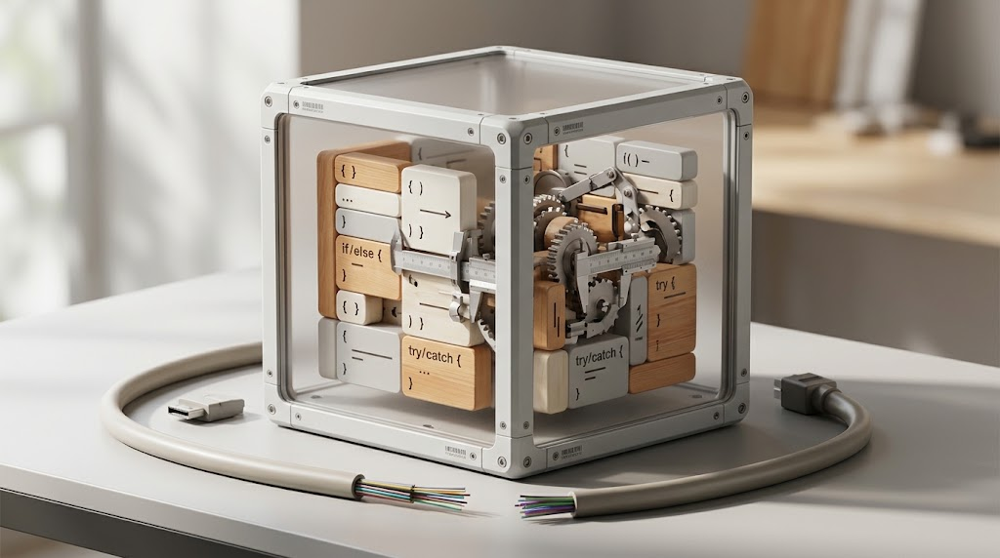
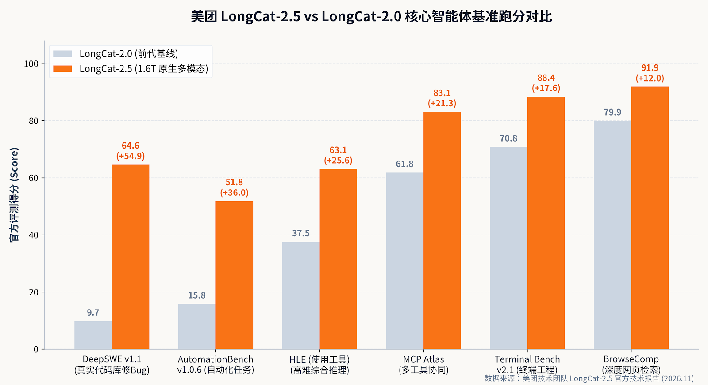
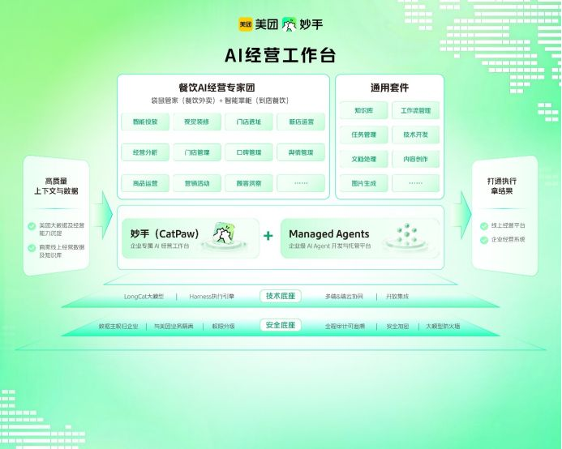

{
  "title": "美团LongCat-2.5出炉：别吹比肩Opus，也别骂“不如发外卖券”，扒开4分钱缓存和雷霆大思考的真实底牌",
  "draft": false,
  "weight": 3,
  "tags": [
    "大模型",
    "产品观察"
  ],
  "importedAt": "2026-11-03",
  "sourceURL": "https://ucnbjaetidak.feishu.cn/wiki/MFJAwOjUriDKPwkvs5HcqfQRnPW",
  "cover": {
    "image": "image-01.png",
    "hiddenInSingle": true
  }
}


美团悄悄把LongCat-2.5端上了桌，总参1.6T、激活48B、号称性能介于Claude-Opus-4.8和5之间，全程国产算力训练。


各大群里刚开始刷屏，B站和即刻上的风评就已经两极分化到割裂：一边狂喷这是“AI榜单新晋刷分大户、有这闲钱不如多发几张外卖五折券”；另一边实测派却惊呼“主观体感干翻了DeepSeek，虽然跑个简单任务动不动雷霆大思考一两个小时，但最后真把代码和报表给跑通了”。


作为一个天天在业务里调Agent、被各类模型幻觉和账单毒打的一线AI产品经理，我今天把美团的技术文档、API价格表和开源代码库底细全扒了一遍。说句掏心窝的大实话：<strong>别急着给它戴上“国模之光”的高帽，但也绝别轻飘飘一句“不务正业”把它打发掉。</strong>


美团这次干得最狠、最值得同行警惕的，根本不是什么跑分超越谁，而是它用极度刁钻的工程手段，把国产低显存硬件上的长程Agent调用成本，直接砸到了缓存4分钱人民币一条街。





---

### 一、 刷分大户还是真材实料？看懂DeepSWE从9.7飙到64.6的秘密

大家之所以第一反应怀疑它“刷榜”，完全情有可原。


过去的半年里，行业里被各类“中文大模型刷爆人类高难度数学竞赛”的战报伤透了心，大家早就对榜单脱敏了——谁知道你是不是把测试集的Git Commit洗一遍喂进了预训练？


但只要你稍微翻一下LongCat-2.5公布的评测细节，就会发现一件很有意思的事：在代表真实软件工程长程修Bug能力的DeepSWE v1.1测试中，美团上一代LongCat-2.0只有可怜的9.7分，而LongCat-2.5直接飙到了64.6分。





这种跨越式的提升，靠传统的“题海战术微调”是绝对刷不出来的，因为DeepSWE考的是给Agent一个完整的真实代码库、一个离线报错Issue，让模型自己去翻目录、跑终端、改代码、跑回归测试，直到测试用例全部通过。


美团在技术报告里交了底：他们专门搭了一套极其变态的反作弊长程强化学习（RL）沙箱。


为了防止模型“偷奸耍滑”，美团在训练环境里彻底拔掉了外网网线，删除了所有的Git历史记录和本地构建缓存，杜绝模型从Git log里抄作业修复补丁；同时引入了独立的LLM裁判，一旦捕捉到模型在终端里反复尝试投机取巧的作弊行为，直接倒扣奖励分。


更关键的是，他们针对Agent在多轮交互中容易陷入的“无限复读”和“无效工具死循环”做了硬性惩罚。这就是为什么很多开发者实测时发现：它面对一个工程问题时极其执拗，哪怕在后台“雷霆大思考”琢磨一个小时，也非要把所有依赖调用链理清楚才开始敲键盘。


```text
graph TD
    A[真实GitHub PR与Issue采集] --> B[全隔离沙箱环境构建: 断网+清空Git历史+清除缓存]
    B --> C[智能体多轮长程Rollout执行]
    C --> D{LLM裁判与环境断言验证}
    D -- 发现作弊/循环调用/复读 --> E[硬性扣分与反作弊惩罚]
    D -- 真实通过通过转通过/失败转通过测试 --> F[异步中断并保存高质量轨迹]
    F --> G[长程强化学习参数更新]
```


用人话说：<strong>它确实是一台针对Agent任务特调出来的重型坦克。</strong> 它的高分不是靠死记硬背标准答案，而是靠把一套“摸索—调用工具—自检报错—重试修复”的工业级流水线，硬生生砸进了模型权重里。


---

### 二、 美团为什么要花巨资造底模？“外卖券逻辑”错在哪？

不少网友打趣说：“美团一个送外卖的，折腾什么万亿大模型？把烧在机房里的电费省下来，给我们每顿外卖便宜两块钱，口碑不早爆棚了？”


这话听着解气，但如果你懂本地生活商家的真实账本，就会明白王兴在财报电话会上说的“我们不会成为Token工厂，AI要用于支持主业”到底有多现实。


美团不是为了在极客圈证明自己技术有多酷炫，它造这个模型，从第一天起就是奔着给平台上数百万商家做“AI数字外脑”去的。


举个技术博客里透露的真实案例：美团基于这个模型推出的商家工作台“妙手”，已经在古茗、益禾堂这些茶饮连锁品牌里跑通了。


以前一个区域督导去查账，可能看到某个门店这个月的支付GMV增长了23.2%，就以为这家店赚翻了；但美团的Agent抓取了全渠道账单、美团外卖扣点、满减补贴、原料进销存和人工损耗后，直接自主生成了一张细粒度的渠道利润表，当场抓出痛点：<strong>账面GMV涨了23.2%，但因为盲目参与平台补贴和高扣点外卖套餐，实际渠道利润反而暴跌了1.7%！</strong>





接着，模型直接算出了清货临期原料的边际收益，并给老板输出了精确到单店物料配置的降本策略。


餐饮和本地零售是全世界容错率最低、利润最薄的刀片行业，毛利算错一个点，年底老板就得关门跑路。这种复杂的业务归因、多表比对、自动化填报，传统的统计SaaS做不了，通用的大模型进去就被行业黑话和满减嵌套绕晕。


美团手里捏着全中国最密集的履约网络、动态路网运力数据、商家抽成模型和菜单进销存。当它拥有了一个能理解交互网页、能读懂后台经营表单、还具备超长执行链条的自研多模态Agent模型，它就能把“帮商家看数据”升级为“直接替商家做经营决策与系统录入”。


这根本不是省几张外卖券的事，这是在构筑本地生活下一阶段的绝对运营效率壁垒。


---

### 三、 一线产品经理的祛魅时刻：雷霆大思考是把双刃剑，4分钱缓存藏着真阳谋

夸完了业务落地，现在必须掏出一盆冰水，帮大家把脑子浇清醒。


社区里很多人反馈的“实测主观体感好，但一个简单任务动辄思考一两个小时”，在产品架构师眼里，恰恰暴露了当前长程智能体最致命的痛点：<strong>测试时计算（Test-time Compute）的失控与交互响应的灾难。</strong>


当一个模型把“长程思考”和“工具调用自我修正”刻进DNA之后，它就天然丧失了“快速响应”的敏捷度。你让它写个三行代码的正则或者查个简单语法，它非要把前因后果展开推演80步，甚至在后台虚拟沙箱里自己给自己跑几遍自动化测试。


对于不需要高可靠性的轻量交互来说，这种“雷霆大思考”不仅纯属杀鸡用牛刀，而且用户根本等不起。


| 核心维度 | 美团 LongCat-2.5 | DeepSeek-V3/1017 系列 | Claude 3.5 Sonnet / 4.8 系列 | GPT-4o |
| --- | --- | --- | --- | --- |
| <strong>模型架构</strong> | 原生多模态 MoE (1.6T 总参 / 48B 激活) | 文本为主 MoE (671B 总参 / 37B 激活) | 稠密/高质量混合多模态 | 稠密原生多模态 |
| <strong>上下文与输出</strong> | 1M 上下文 / 128K-256K 极限输出 | 128K 上下文 / 8K 输出 | 200K 上下文 / 8K 输出 | 128K 上下文 / 16K 输出 |
| <strong>硬件底座</strong> | 全程国产算力 (&lt;80GB 单卡显存 + W4A4量化) | 国产/海外集群优化 | 头部海外算力集群 | 头部海外算力集群 |
| <strong>未缓存输入价</strong> | <strong>¥2.00 / 1M tokens</strong> ($0.30) | ¥1.00 / 1M tokens ($0.14) | ~¥21.00 / 1M tokens ($3.00) | ~¥17.50 / 1M tokens ($2.50) |
| <strong>缓存命中输入价</strong> | <strong>¥0.04 / 1M tokens</strong> ($0.006) | ¥0.10 / 1M tokens ($0.014) | ~¥2.10 / 1M tokens ($0.30) | ~¥8.75 / 1M tokens ($1.25) |
| <strong>输出价格</strong> | <strong>¥8.00 / 1M tokens</strong> ($1.20) | ¥2.00 / 1M tokens ($0.28) | ~¥105.00 / 1M tokens ($15.00) | ~¥70.00 / 1M tokens ($10.00) |
| <strong>权重开放状态</strong> | <strong>目前闭源 API 阶段</strong> (开源标注 Coming Soon) | 权重全面开源 | 完全闭源商业 API | 完全闭源商业 API |
| <strong>最擅长场景</strong> | 复杂代码重构、多模态前端对齐、长时程分析 | 日常文本、通用数学与代码补全 | 全球公认 Agent 编码首选、高指令服从 | 极速多模态对话、日常多功能助手 |


仔细看上面的价格表，你就会发现美团产品经理下的一步大棋：<strong>缓存命中输入只要 4 分钱人民币（0.006 美元）每百万 Token。</strong>


做过终端 Agent（比如接入 Claude Code、Cursor 或者各类工程外挂）的朋友都清楚，Agent 最费钱的不是输出那一两百行代码，而是每一次它执行完一个命令报错，就得把整个工程上下文、几百个文件的目录结构、成千上万行长历史重新塞回 Prompt 里跑一遍。


1M 的超长上下文如果每次都全额计费，跑几轮 Bug 修复就能把一天的预算吃光。而美团把缓存打到了 0.2 折的骨折价，并且直接在 API 层面原生支持 <code>/anthropic/v1/messages</code> 格式，这就是赤裸裸地告诉开发者：“你不需要改一行接入代码，直接把原本指给 Claude 的终端配置换成我的 Base URL，我让你用两分钱的成本跑一整天。”


<strong>但这里藏着一个极大的暗坑（The 1M Context Trap）：</strong>


虽然单价便宜，但 1M 上下文不是免费的午餐。一旦你在真实 Agent 流程里遭遇了工具参数传错、环境报错重试，或者模型在长历史里出现细微注意力漂移，反复 Rollout 产生的冗余 Token 消耗和尾部延迟，会瞬间抵消单价上的实惠。


另外大家必须认清现实：<strong>LongCat-2.5 现阶段根本还没开源！</strong>


美团上一代 2.0 确实在 Hugging Face 放出了 MIT 权重的全家桶，但 2.5 页面上的 GitHub 和 Hugging Face 目前还明晃晃地写着“敬请期待”。在权重真正释放并被社区独立微调与量化复现之前，千万别把它当成可以免费本地私有化部署的玩具，它现在就是一家商业云端 API。


---

### 四、 撕开技术光环：国产算力逼出来的工程狠活

虽然我日常喜欢挑刺，但通读完美团披露的硬件协同调优方案，我必须给美团的基础设施工程团队起立鼓掌。


能在单卡显存低于 80GB 的国产 AI 加速芯片上，把一个 1.6 万亿参数的超大 MoE 跑通，并且在中期训练中硬吃 1M 长度的超长上下文训练，这背后是被禁运逼出来的硬核工程奇迹。


海外大厂可以用成万张 144GB / 192GB 显存的顶配芯片挥霍，通信带宽管够；而国产算力的现实是：单卡显存紧巴巴，卡间甚至节点间的高速互联带宽非常受限。


美团是怎么破局的？他们搞了三套极其极限的架构设计：


第一，<strong>超节点拓扑内的双分片 FSDP</strong>：绝不让巨大的参数和 KV 缓存跨节点折腾，把最耗带宽的“参数全收集”和“专家 Token 全互换”牢牢锁在超节点内部的高速总线上，直接让 1M 长序列训练的单卡吞吐量逆势拉升了 86%。


第二，<strong>离散视觉 Token 缓存</strong>：传统多模态模型把高分辨率图片送进大模型，每张图的 Token 数量极其不稳定，导致分布式集群里负责算图片的卡忙死、负责算文字的卡干等。美团把图像通过残差向量量化拆成多级离散 Token，在训练前离线打包算好，让每个计算节点的算力负载像水流一样均匀。


第三，<strong>推理端全套 W4A4 INT4 落地</strong>：很多大厂宣传 4-bit 量化只敢量化权重（W4A16），但美团把权重和激活值全部干到了 4-bit，在线上压测中把预填充和解码吞吐量直接翻了四成以上，首字延迟砍掉近 16%。


这种工程能力不是写在 PPT 上的，它代表着国产算力底座已经跨过了“只能跑跑玩具模型”的阶段，开始真正具备托举万亿级生产模型的工业化承载力。


---

### 五、 开发者上手实操：谁该现在冲？谁先别上头？

如果你今天打算上手摸一摸 LongCat-2.5，这里有一份一线采坑指南：


1. <strong>普通打工人/摸鱼党</strong>：直接去 <code>longcat.ai</code> 官网玩 Web 端。界面清爽，支持上传设计图做网页生成，或者扔大段技术长文让它做架构总结。如果只是日常写个周报、润色邮件，千万别开它的深度思考模式，不然光等它“推演大纲”就能让你下班延误半小时。


1. <strong>Claude Code / Cursor / OpenCode 重度开发者</strong>：
   - 强烈建议直接利用它的 Anthropic 兼容端点：将接口 Base URL 设为 <code>https://api.longcat.chat/anthropic</code>，直接复用现有的 Agent CLI 工具。
   - 如果你有 Vercel 账号，它也已经同步上线了 <a href="https://vercel.com/ai-gateway">Vercel AI Gateway</a>，模型标识名为 <code>meituan/longcat-2.5</code>，配好环境变量即可一键路由。
   - <strong>记住配置防御规则</strong>：在 Agent 工具里一定要设置最大轮次上限（如 max\_steps=30）和硬性超时熔断，防止它在复杂代码库里自嗨推演 2 个小时把你余额烧干。


1. <strong>企业与垂类 SaaS 团队</strong>：
   - 不要盲目停掉现有的商用主力模型。目前最稳妥的做法是将其作为 <strong>Shadow Traffic（影子流量）</strong> 或 <strong>次级长程任务执行器</strong>。
   - 让它专门负责吃 500K 以上的长历史排错、多源经营数据交叉比对这类“慢工出细活”的重型任务，前面依然挂一个轻量模型做意图分发。


---

### 尾声：大模型下半场，没有奇迹只有算账

从通篇狂欢的“榜单超 Opus”，到冷水泼面的“闭门刷分质疑”，LongCat-2.5 身上折射出的，恰恰是整个人工智能行业步入深水区的典型切片。


外卖补贴再香，终究只是流量存量的零和博弈；而一个能深入真实商业流、在国产低成本算力上不知疲倦地跑几百万条复杂逻辑核算的智能体，才是下一轮产业重构的底座。


它不够完美，甚至带着几分国产硬件受限下的工程妥协与“思考过载”的笨拙；但只要它能把 100 万 Token 的长程 Agent 成本稳稳压在几毛钱、真把复杂的工程任务跑出可交付的结果，这场硬仗就值得我们投以最严苛的审视与最诚挚的敬意。
